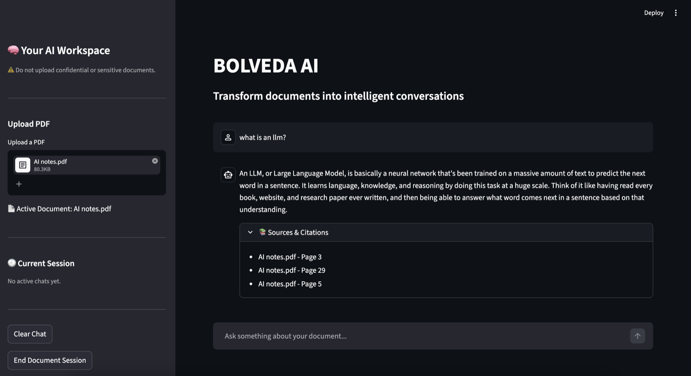
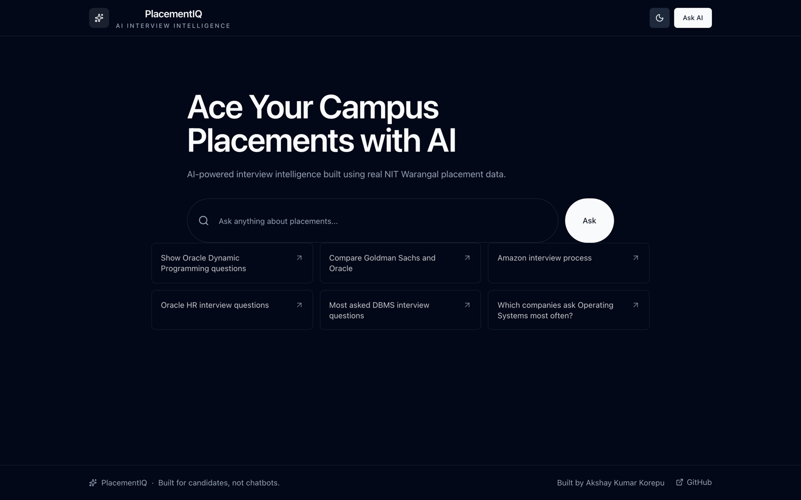
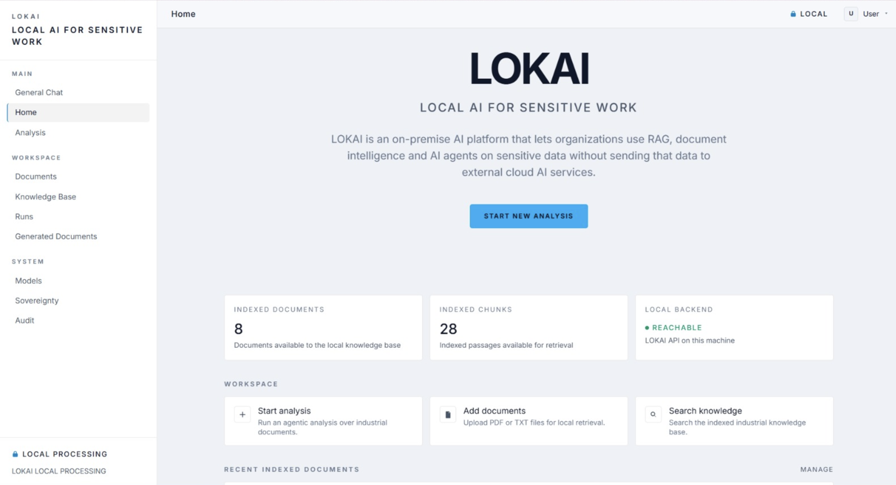
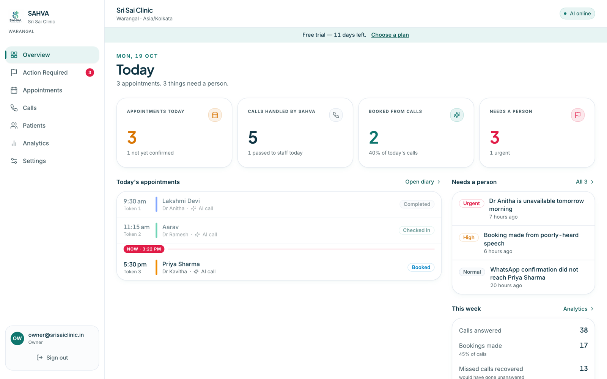

<p align="center">
  
</p>

<p align="center">
  <a href="https://akshaykumarkorepu.vercel.app">
    
  </a>
</p>

<p align="center">
  <a href="https://akshaykumarkorepu.vercel.app"></a>
  <a href="https://www.linkedin.com/in/akshaykumarkorepu/"></a>
  <a href="https://github.com/akshaykumarkorepu"></a>
</p>

---

## About me

I'm a **Mathematics & Computing** student at **NIT Warangal**, working at the intersection of software engineering, machine learning, and AI systems.

I like understanding how things work underneath the abstraction layer: taking an idea from a rough concept, designing the architecture, building the system, and **measuring whether it actually works**.

- **Focus:** AI engineering, Generative AI, LLM applications, RAG, and agentic AI
- **Exploring:** Forward Deployed Engineering — working close to real users, prototyping fast, and deploying AI that holds up outside the lab
- **Building:** practical AI-powered products, from document intelligence to clinic automation

---

## Featured projects

### BOLVEDA — Grounded Document Q&A with RAG



A retrieval-augmented generation system for contextual PDF question answering. Each upload gets its own isolated vector store; answers are retrieved with MMR search and streamed from Llama 3.3 70B, grounded in the document — or it says the answer isn't there.

- **27/30 (90%)** on a 30-question benchmark · **10/10** factual · **10/10** out-of-scope refusals
- Session-isolated ChromaDB stores, local MiniLM embeddings, separate reproducible evaluation pipeline

`Python` `LangChain` `ChromaDB` `HuggingFace` `Groq` `Llama 3.3 70B` `Streamlit` `SQLite`

[Repository](https://github.com/akshaykumarkorepu/BOLVEDA-AI)

---

### PlacementIQ — Interview Intelligence Platform



Turns unstructured campus interview experiences into structured, searchable interview intelligence. A LangGraph extraction pipeline pulls companies, rounds, topics, and questions out of raw write-ups, with confidence scoring that flags uncertain extractions for review.

- **100+** interview experiences processed · **30+** companies mapped
- Agentic extraction-and-verification workflow behind a natural-language search interface

`Python` `FastAPI` `LangChain` `LangGraph` `SQLite` `React` `TypeScript`

[Live demo](https://placementiq-three.vercel.app/) · [Repository](https://github.com/akshaykumarkorepu/PlacementIQ)

---

### LOKAI — Local AI for Sensitive Work



An on-premise AI platform for confidential industrial documents, built by **Team JAVAST** (*Six Minds. One Build.*) for Smart India Hackathon 2026. Documents, models, and processing never leave the organisation's machine.

- **Agentic analysis:** a planner breaks each request into steps; an executor runs retrieval, document-reading, and calculator tools
- **Built-in verification:** evidence, calculation, and consistency checks mark every result *verified* or *needs review*
- **Generated approval notes** as Word documents, plus a local audit trail of every model call and agent step
- **My role:** built the local RAG pipeline — embeddings, ingestion, pgvector storage, retrieval, and grounded generation

`Python` `FastAPI` `PostgreSQL` `pgvector` `Ollama` `Qwen3` `React` `Vite`

[Repository](https://github.com/SatwikaGanji06/TEAM-JAVAST)

---

### SAHVA — AI Voice Receptionist for Clinics &nbsp;



An AI receptionist for small clinics, built for Telugu and English callers. PostgreSQL decides what's free and what gets booked, so the AI can only confirm a slot the clinic's diary accepts. **I'm the founder.**

- **Implemented:** live slot availability, guarded booking with no double-booking, and a staff dashboard for appointments, patients, call records, analytics, and an *Action Required* queue
- **In development:** the telephony channel for live calls
- Multi-tenant isolation with row-level security, covered by PostgreSQL test suites

`TypeScript` `Next.js` `Express` `Supabase` `PostgreSQL` `Claude API` `Tailwind CSS`

<sub>Screenshot shows the dashboard in demo mode with sample data.</sub>

---

## Tech stack

**Languages**

     

**AI & ML**

     

**Engineering**

     

**Tools**

    

---

## Achievements

**Awards**
- 🏆 **Winner — Smart India Hackathon 2025**, Internal Round, NIT Warangal
- 🏅 **IMO & ISO Olympiad medals**, earned during school

**Programs & selections**
- 🚀 **Selected — [Dorm2VC](https://dorm2vc.io/) Cohort 1**, the inaugural cohort, as a founder
- 🎓 **Shortlisted — ML Summer School 2026**, second round

**Milestones**
- 💻 **300+ coding problems solved** across LeetCode and GeeksforGeeks

<sub>More — leadership roles, athletics, and workshops — on the <a href="https://akshaykumarkorepu.vercel.app">live portfolio</a>.</sub>

---

## About this repository

The source for my personal portfolio, live at **[akshaykumarkorepu.vercel.app](https://akshaykumarkorepu.vercel.app)**.

     

- Dark, blue-accented design with Framer Motion animations that respect `prefers-reduced-motion`
- Responsive from 320px phones to wide desktops, with a dedicated mobile menu and 44px touch targets
- Statically prerendered; no environment variables or external services required

```bash
npm install
npm run dev        # http://localhost:3000
npm run build      # production build
npm run lint       # ESLint
```

**Updating content:** all text — projects, experience, skills, achievements, and contact links — lives in [`src/data/index.ts`](src/data/index.ts). Project screenshots are in [`public/images/projects/`](public/images/projects/).

---

<p align="center">
  <a href="https://akshaykumarkorepu.vercel.app"><b>Portfolio</b></a> &nbsp;·&nbsp;
  <a href="https://www.linkedin.com/in/akshaykumarkorepu/"><b>LinkedIn</b></a> &nbsp;·&nbsp;
  <a href="https://github.com/akshaykumarkorepu"><b>GitHub</b></a>
</p>

<p align="center">
  
</p>
